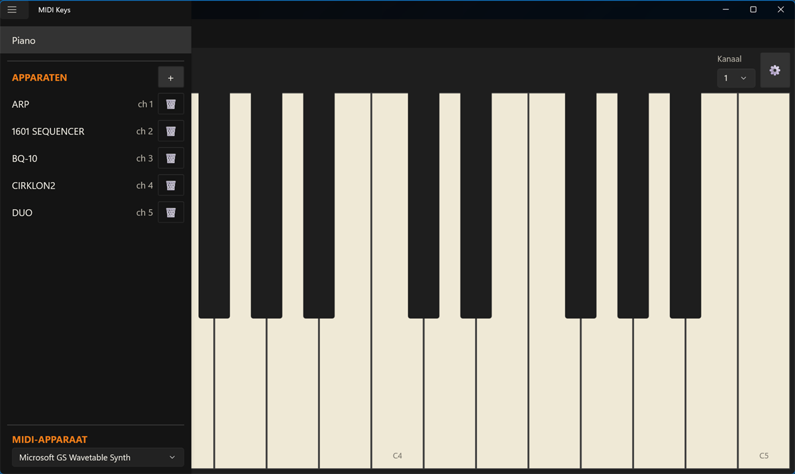
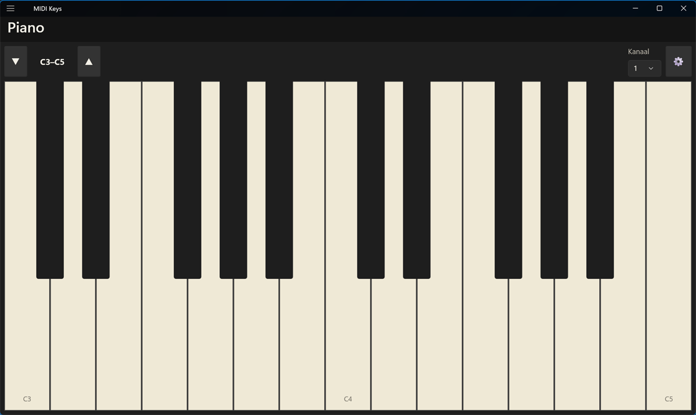
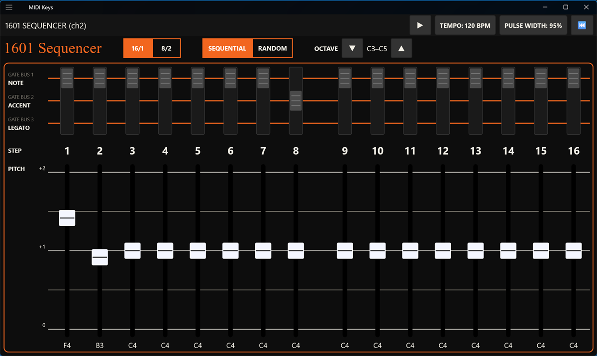
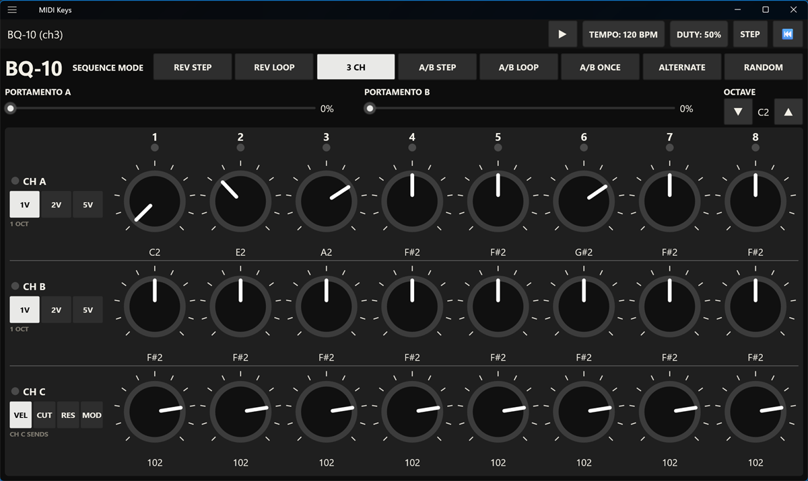
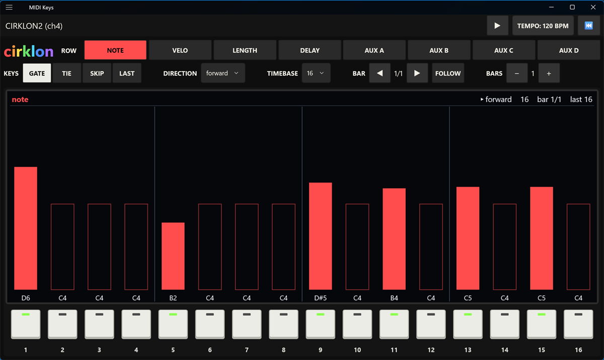
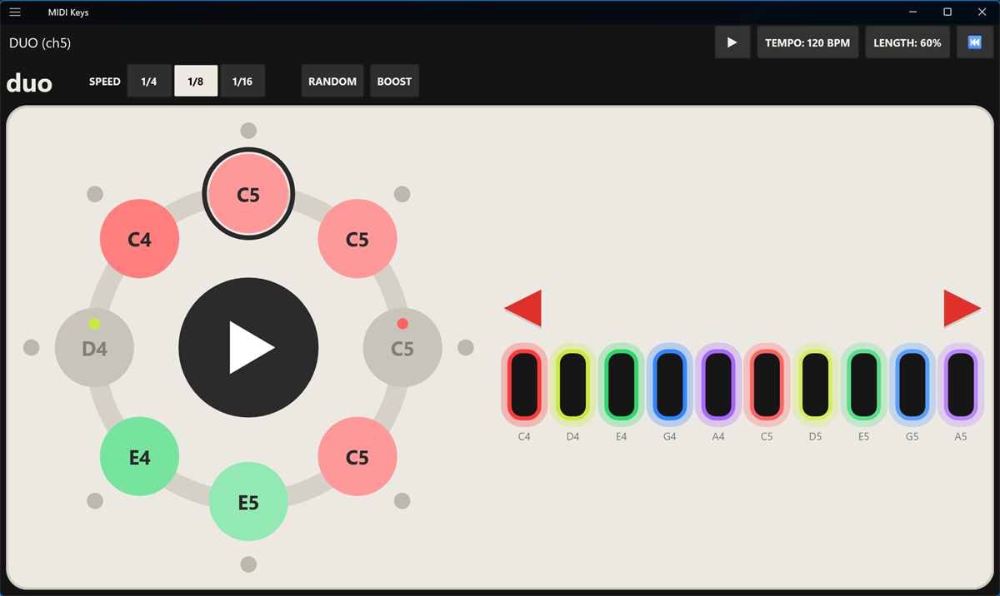
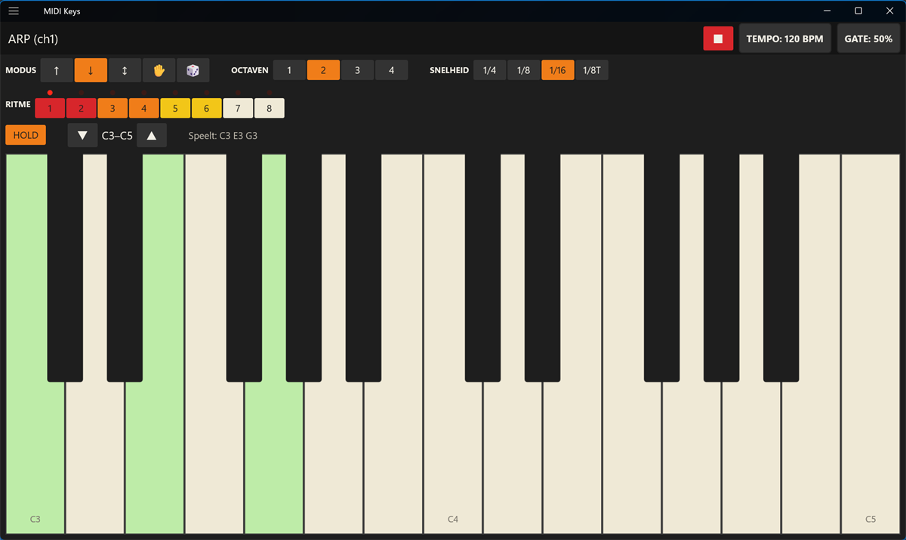

# MIDI Keys

A .NET MAUI app (Android and Windows) with a multitouch piano keyboard, step sequencers and an
arpeggiator that send MIDI over a class-compliant USB MIDI cable (e.g. CME C2MIDI Pro) to a
synth with 5-pin DIN. Per MIDI channel you add views: a **1601 SEQUENCER**, a **BQ-10**, a
**CIRKLON2**, a **DUO** or an **ARP**. Each sequencer takes the look of the hardware it is named after,
but with large controls that fill the screen, so it stays easy to use on a tablet. The rest
of the app follows the Roland TR-808: charcoal panel, off-white print and orange accents.

> **Made with AI.** This app was built with [Claude Code](https://claude.com/claude-code)
> (Anthropic): the code, this README and the screenshots were produced by the AI, directed
> and tested by hand.

## Contents
- [Getting started](#getting-started)
- [Side menu](#side-menu)
- [Piano](#piano)
- [1601 Sequencer](#1601-sequencer)
- [BQ-10](#bq-10)
- [Cirklon2](#cirklon2)
- [DUO](#duo)
- [Arp](#arp)
- [Build & run](#build--run)
- [Connecting](#connecting)
- [Structure](#structure)
- [How it works](#how-it-works)

## Getting started
1. Plug in the USB MIDI cable and connect its **OUT** to the synth's **MIDI IN**. The app
   connects to it by itself; you can choose the device at the bottom of the side menu.
2. Open the side menu (☰, top left), tap **+** next to **APPARATEN**, choose the device and
   then the MIDI channel it plays on.
3. Set the synth (or a part of a multitimbral synth) to that channel, press ▶ in the title bar
   and tap **TEMPO** next to it to set the tempo.
4. Add more devices on the same or other channels: they all play on one shared clock and stay
   in step, also while you switch pages or play the piano over them.

## Side menu


The hamburger menu (top left) holds:
- **Piano**
- **APPARATEN**: the list of devices you added, sorted by channel, each with the MIDI channel
  it plays on behind it (e.g. *1601 SEQUENCER · ch 2*). The **+** adds one: choose the device,
  then the channel; the channel list shows what already plays on each channel. Several devices
  can share a channel, also of the same kind (they are then numbered, e.g. *1601 SEQUENCER 2*).
  The 🗑 behind a device removes it (after asking) together with its stored settings.
In the title bar of every view, **TEMPO** and the gate length (GATE, PULSE WIDTH, DUTY or
LENGTH) show as *name: value*, e.g. *TEMPO: 120 BPM*. Tap one to change it in a popup with the
value in large type, a slider and − / +; changes apply right away, **OK** or a tap beside the
popup closes it. There is one tempo (30–300 BPM) for all views: they run on a shared clock and
stay in step, so changing it in one view changes it everywhere.
- **MIDI-APPARAAT** at the bottom: choose the output. Connected, it shows just the device; when
  nothing is connected, a short message says why (no cable, connecting, failed).
  Connects automatically as soon as you plug in the cable; disconnects cleanly when you unplug it.

| View | After | Steps | Edit by |
|---|---|---|---|
| 1601 SEQUENCER | Behringer 1601 / ARP 1601 | 16, or 2 × 8 | sliders, gate-assign switches |
| BQ-10 | Behringer BQ-10 / Korg SQ-10 | 3 rows × 8 | knobs, sequence mode |
| CIRKLON2 | Sequentix Cirklon2, one track with a P3 pattern | 1–16 bars × 16 | row view bars, step keys |
| DUO | the sequencer side of the Dato DUO | 8 in a ring | step buttons, pentatonic keys |
| ARP | – | 8-step rhythm | buttons and its own keyboard |

Views, their channels, patterns and settings are saved and come back on the next start.

On Android the app runs full screen (swipe from the edge to show the system bars briefly).

## Piano


- 2 octaves + top C, multitouch (chords, sliding across keys), haptic feedback
- Pressed keys light up from pale (soft) to saturated orange (hard) according to the velocity
- ▼ / ▲ octave (C-1 … C9), MIDI channel 1–16
- Velocity sensitivity (⚙): fixed, position on the key, contact area, accelerometer, or
  automatic. Calibrate with 6 soft and 6 hard taps; per source the app decides whether your
  device can tell soft from hard.
- Sends note-off / All Notes Off when the app goes to the background (no hanging notes)

## 1601 Sequencer


A 16-step sequencer in the style of the Behringer 1601 (after the ARP 1601): black with orange
lines, an orange title, slide switches on orange gate-bus lines and sliders with lit caps. The
steps fill the whole window, so the sliders are as long as possible. Each step is a sixteenth note.
- **GATE ASSIGN**: per step a slide switch on the three gate buses; tap the bus you want:
  - **GATE BUS 1 · NOTE**: a note
  - **GATE BUS 2 · ACCENT**: an accented note (velocity 127 instead of 96)
  - **GATE BUS 3 · LEGATO**: a note held into the next step; the same pitch becomes one tied note
- **Step number**: tap to go through play → **REST** (no note) → **SKIP** (passed over) →
  **RESET** (jumps straight back to step 1); the number shows what the step does
- **Slider** per step: 2 octaves in semitones, lines every half octave, note name below. The
  cap is white when the step sounds, blue on the current step, and dark on a rest or skip.
- **16/1 – 8/2**: one 16-step sequence, or two independent 8-step sequences A1–A8 and B1–B8 as
  two voices on the same channel
- **SEQUENTIAL – RANDOM**: forward or random order
- **OCTAVE** ▼ / ▲: the slider range
- In the title bar: ▶/■ start/stop, **TEMPO** and **PULSE WIDTH** (gate length 5–95 % of a
  step), ⏮ back to step 1

The three gate buses are separate gate outputs on the 1601; here they mean note, accent and
legato because that is what is useful over MIDI.

## BQ-10


A 3 × 8-step sequencer in the style of the Behringer BQ-10 (after the Korg SQ-10): dark grey
panel, white print, black knobs and red LEDs. Each step is a sixteenth note.
- Three rows of eight knobs; drag a knob up or down to turn it. A LED above each step and one
  per row show what is playing.
  - **CH A** and **CH B**: pitch, quantised to semitones, note name below. The **1V / 2V / 5V**
    switch sets the range to 1, 2 or 5 octaves, starting at the **OCTAVE** above.
  - **CH C**: sends per step the velocity (**VEL**) or a controller: **CUT** (CC 74),
    **RES** (CC 71) or **MOD** (CC 1). C always runs on, so it plays twice over a 16-step A+B
    sequence.
- **SEQUENCE MODE**, the eight positions of the BQ-10 (names from its quick start guide):

  | Button | On the BQ-10 | What plays |
  |---|---|---|
  | REV STEP | Loop reverse stepped | A, then B backwards; only STEP moves it on |
  | REV LOOP | Continuous reverse | A, then B backwards, looping |
  | 3 CH | Three channel | A, B and C side by side; A and B as two voices |
  | A/B STEP | A/B single stepped | A, then B; only STEP moves it on |
  | A/B LOOP | A/B continuous | A, then B, looping |
  | A/B ONCE | A/B single | A, then B, then it stops |
  | ALTERNATE | A/B alternate | A1, B1, A2, B2 … |
  | RANDOM | Random | random steps from A and B |

- **PORTAMENTO A / B**: sent as CC 5 (portamento time) and CC 65 (on/off) before the notes of
  that row; it works if your synth responds to them
- In the title bar: ▶/■ start/stop, **TEMPO** and **DUTY** (gate length 10–90 % of a step),
  **STEP** (one step on while it is stopped), ⏮ back to step 1

Unlike the hardware, A and B both play on the channel of the view (the BQ-10 sends B on the
next channel when they run separately). Left out because they do nothing over MIDI: the jacks,
the trigger processor, the log / antilog and adding amps, and the 8V (Hz/V) range.

## Cirklon2


One track of a Sequentix Cirklon2 with a P3 pattern, after the pattern edit page of the
Cirklon (operation manual 1.22): a colour screen with the row view above 16 white step keys
with LEDs.
- **ROW**: note, velo, length, delay and aux A–D. The screen shows a bar per step for that row,
  filled when the step is active, with the value below it. Drag a bar up or down to change the
  value, like turning the step encoder.
  - **length** counts in 48ths of a step up to one step (`:24`), then in quarters (`6:1` = 6¼
    steps), up to 16 steps. A length under one step shows as a narrow bar. A note can sound
    longer than its step and overlap the next notes.
  - **delay** (0–47) starts the note that many 48ths of a step late.
  - **aux A–D** each send a MIDI CC on the steps where that aux is on, for example to move a
    filter step by step. By default A = CC 1 (mod wheel), B = CC 74 (cutoff), C = CC 71
    (resonance), D = CC 10 (pan); **CC** ▼ / ▲ changes the number of the selected aux row.
- **KEYS**: what the step keys switch:
  - **GATE**: the step plays a note (on an aux row this button is named after the row and
    switches that aux)
  - **TIE**: the note sounds until just after the start of the next step
  - **SKIP**: the step is passed over, in every direction
  - **LAST**: tap a step key to make it the last step of the bar

  With TIE or SKIP the gates show as small green LEDs under the keys. The red LED under a key
  is the step that plays.
- **DIRECTION**: forward, reverse A, reverse B, alternate, pendulum, random, brownian,
  eitherway, as described in the Cirklon manual
- **TIMEBASE**: the length of a step: 1, 2, 4, 8, 16, 32, 64 and the triplets 2T–64T (default 16)
- **BAR** ◀ / ▶ chooses the bar you see and edit; **FOLLOW** follows the bar that plays.
  **BARS** − / + sets the pattern length (1–16 bars); a new bar starts as a copy of the last one.
- In the title bar: ▶/■ start/stop, **TEMPO**, ⏮ back to step 1

Not taken over: song mode, scenes and the other tracks, the "hold" length, the X flag (there is
no transpose), aux events other than CCs, the polyrhythm timebase, gang and slope edit.

## DUO


The round sequencer of the Dato DUO, the synth for two players: a light body with a ring of 8
big round step buttons around a start/stop button, and a two-octave pentatonic keyboard: one
row of ten tall black keys with a glowing coloured edge (red, lime, green, blue, violet per
octave), with a red arrow on either side for the octave. Every note comes from
the pentatonic scale, so whatever you enter sounds good; easy for children too. The synth side
of the DUO is your own synth.
- **Step buttons**: tap to switch a step on or off; it shows the colour and name of its note
  (an off step keeps a small dot of its colour). A red LED on the ring shows the step that plays.
- **Keys**: stopped, a key sets the note of the chosen step (the dark ring), plays it so you
  hear it, and moves on to the next step, so you tap in a melody note by note. Running, a key
  records into the step that plays.
- **SPEED**: 1/4, 1/8 (default) or 1/16 notes per step
- The two **red arrows** above the keyboard: ◀ an octave down, ▶ an octave up (C1–C7; C4 by default)
- **RANDOM**: the steps play in random order; **BOOST**: every note at full velocity
- In the title bar: ▶/■ start/stop (also the button in the middle of the ring), **TEMPO** and
  **LENGTH** (note length 5–95 % of a step), ⏮ back to step 1

## Arp


An arpeggiator with its own keyboard, built so every setting is visible and takes one tap.
- In the title bar: ▶/■ start/stop, **TEMPO** and **GATE** (gate length). Stopped, the keyboard
  plays notes directly.
- **MODUS**: ↑ up, ↓ down, ↕ up and down (no double top or bottom note), ✋ as played, 🎲 random
- **OCTAVEN**: 1–4, **SNELHEID**: 1/4, 1/8, 1/16, 1/8T
- **RITME**: 8 steps that play or rest; a LED above each step shows the one that is playing
- **HOLD** (on by default): the chord keeps playing after you let go; the first key of a new
  chord replaces it. Without Hold the arp plays while keys are down.
- ▼ / ▲ octave for the keyboard; the line next to it shows the notes being played
- While it runs, the keys of the notes the arp plays light up green (white keys light green,
  black keys a darker green), so you see which chord is latched; a key you press shows its
  velocity colour on top. Octave copies above the chord are not marked.
- Notes play at the velocity they were played with. When a sequencer is already running, the
  arp falls in on the next step of its rate.

## Build & run
```bash
# Android
dotnet workload install maui-android
dotnet build -t:Run -f net10.0-android

# Windows (unpackaged, mouse / pen / touchscreen)
dotnet workload install maui-windows
dotnet run -f net10.0-windows10.0.19041.0
```
In Visual Studio choose **Windows Machine** or an Android device/emulator as the target.
Using .NET 9? Change `net10.0` to `net9.0` in `TargetFrameworks` in `MidiKeys/MidiKeys.csproj`.

On Windows the built-in *Microsoft GS Wavetable Synth* is listed last, so you can test
without a cable (it has noticeable latency). There is no accelerometer on Windows; contact
area only works on touchscreens that report it. Hover over an icon button for its tooltip
(long-press on Android).

On Windows you can also play the Piano and Arp keyboards with the PC keyboard, starting at
the leftmost C on screen: white keys `A S D F G H J K L ; '`, black keys `W E T Y U O P`.
Keys play at the fixed velocity. Page Up / Page Down change the octave.

## Connecting
Cable **OUT** → synth **MIDI IN**. Set the synth (or each part of a multitimbral synth) to
the channel of the piano or of the views that should play it.

## Structure
| File | Role |
|---|---|
| `Services/IMidiOutput.cs` | Interface + NoteOn/NoteOff/AllNotesOff helpers |
| `Platforms/Android/AndroidMidiOutput.cs` | `android.media.midi`: device list, hot-plug, sending |
| `Platforms/Windows/WindowsMidiOutput.cs` | `Windows.Devices.Midi`: device watcher, hot-plug, sending |
| `Platforms/Android/MainActivity.cs` | Landscape, screen kept on, full screen |
| `Controls/PianoKeyboard.cs`, `Controls/PianoKeyboardHandler.cs` | MAUI control (BaseNote, MarkedNotes, events) + shared handler |
| `Platforms/Android/PianoKeyboardView.cs` | Native view: drawing + multitouch per pointer |
| `Platforms/Windows/PianoKeyboardView.cs` | WinUI view: same behaviour for mouse, pen, touch and PC keyboard |
| `Platforms/Android/AccelSampler.cs` | Accelerometer ring buffer, gravity filtered out, peak lookup |
| `Services/VelocitySettings.cs` | Velocity config, velocity + calibration math, Preferences |
| `Controls/Theme.cs` | TR-808 colours and default control styles, plus the 1601 and BQ-10 colours |
| `Controls/KeyColors.cs` | Key colours, pressed-key colour from the velocity, light green for marked keys |
| `Controls/PageHeader.cs` | Title bar with the page title left and its main controls right |
| `Controls/ValueButton.cs` | "TEMPO: 120 BPM" style button that opens a popup with a slider and − / + |
| `Controls/MidiDevicePicker.cs` | MIDI device choice; a message only when nothing is connected (side menu) |
| `Pages/SettingsPage.cs`, `Pages/CalibrationPage.cs` | Velocity settings and calibration |
| `MainPage.xaml(.cs)` | Piano page: toolbar and wiring |
| `AppShell.cs` | Side menu: the device list with channels, + / 🗑, MIDI device |
| `Services/Instruments.cs` | The added devices and their channels, stored in Preferences |
| `Services/MusicClock.cs` | Shared tempo and timing thread (24 PPQN), note-off bookkeeping |
| `Services/StepSequencer.cs`, `Controls/SequencerPanel.cs`, `Pages/SequencerPage.cs` | 1601 Sequencer: engine, drawn panel, page |
| `Services/BqSequencer.cs`, `Controls/BqPanel.cs`, `Pages/BqPage.cs` | BQ-10: engine with the sequence modes, drawn knobs, page |
| `Services/CirklonSequencer.cs`, `Controls/CirklonPanel.cs`, `Pages/CirklonPage.cs` | Cirklon2: P3 pattern engine, screen + step keys, page |
| `Services/DuoSequencer.cs`, `Controls/DuoPanel.cs`, `Pages/DuoPage.cs` | DUO: 8-step pentatonic engine, ring, keys and octave arrows, page |
| `Services/Arpeggiator.cs`, `Pages/ArpPage.cs` | Arp: engine with held/latched notes and rhythm, page with its own keyboard |

## How it works
### Velocity measurement
With contact area or accelerometer the note-on is delayed by a measurement window
(default 20 ms). Within it the view collects the largest contact diameter (a finger keeps
flattening for a few ms after touch-down) and the impact peak of the gravity-filtered
accelerometer. Sliding to another key inherits the velocity, without extra delay.
Haptic feedback is switched off while the accelerometer is measuring, because the
vibration would otherwise show up in the measurement.

### Timing
All views run on one clock thread (`MusicClock`) with a `Stopwatch`, independent of the UI,
at 24 ticks per quarter note: a 1601 or BQ-10 step is 6 ticks, a DUO step 24 / 12 / 6, an arp step 24 / 12 / 8 / 6
ticks depending on its rate. The Cirklon2 counts in half ticks, so its 64th timebase (1.5
ticks) also fits; its delayed notes wait in a queue on the same thread. The thread only runs
while something plays; whatever joins a running clock falls in on its grid. It sleeps in 1 ms
slices and yields for the last few milliseconds before a tick or note-off. On Windows it asks
for a 1 ms timer resolution while running (`timeBeginPeriod`), because the default is about
15 ms. If it falls behind (debugger, device sleep), it continues from now instead of
rushing to catch up.

### Drawing
The step panels are drawn in a `GraphicsView` that fills the page. The light that moves with
every step (the lit cap, the step LEDs) is drawn on a separate, transparent layer on top, so
the panel itself only redraws when you change something. That keeps it smooth on older tablets.
